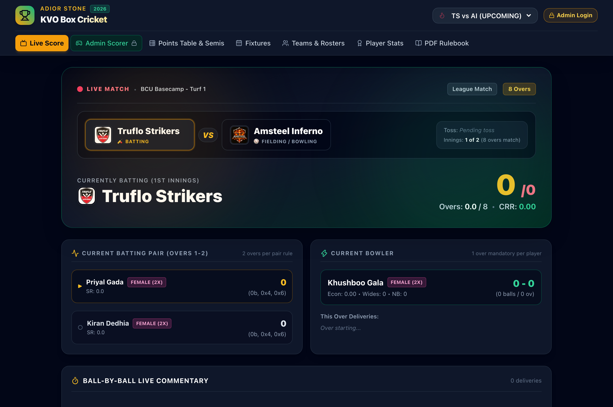
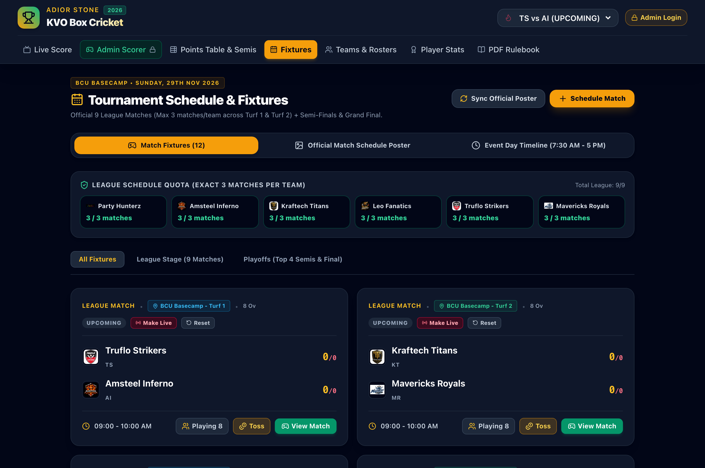
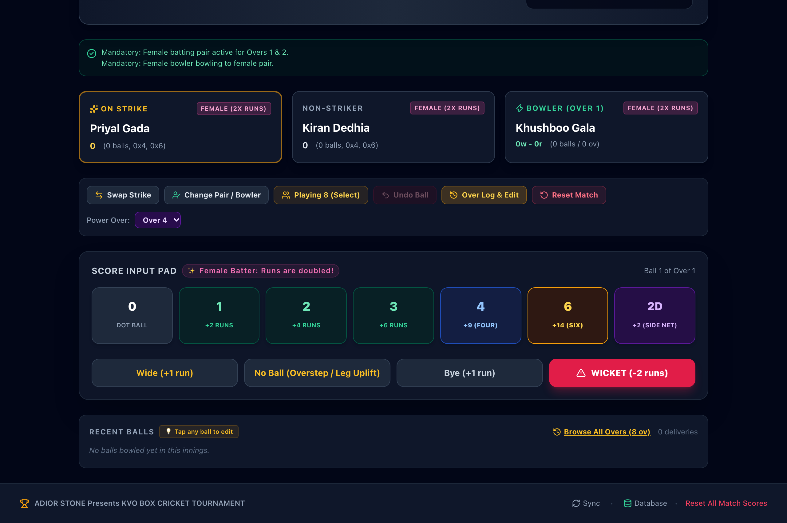
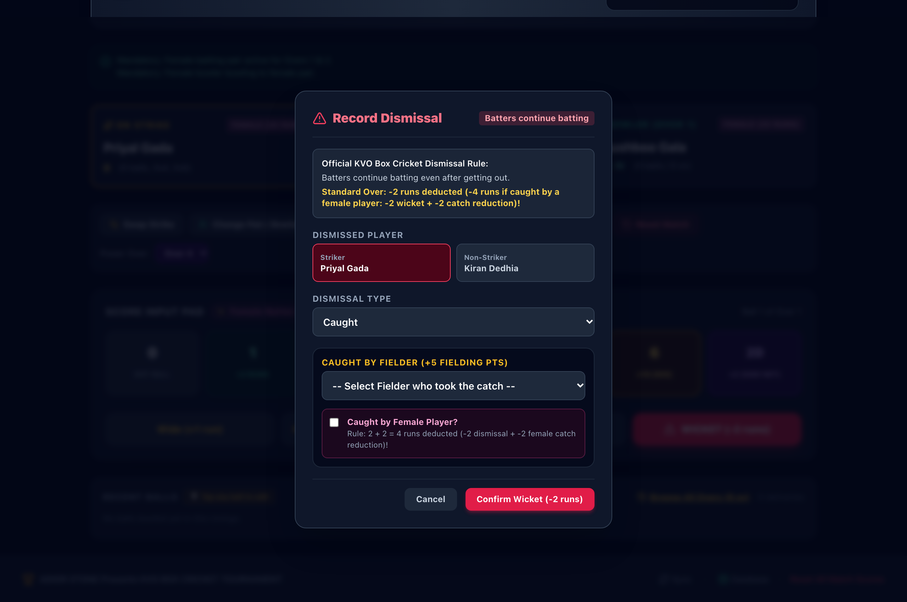
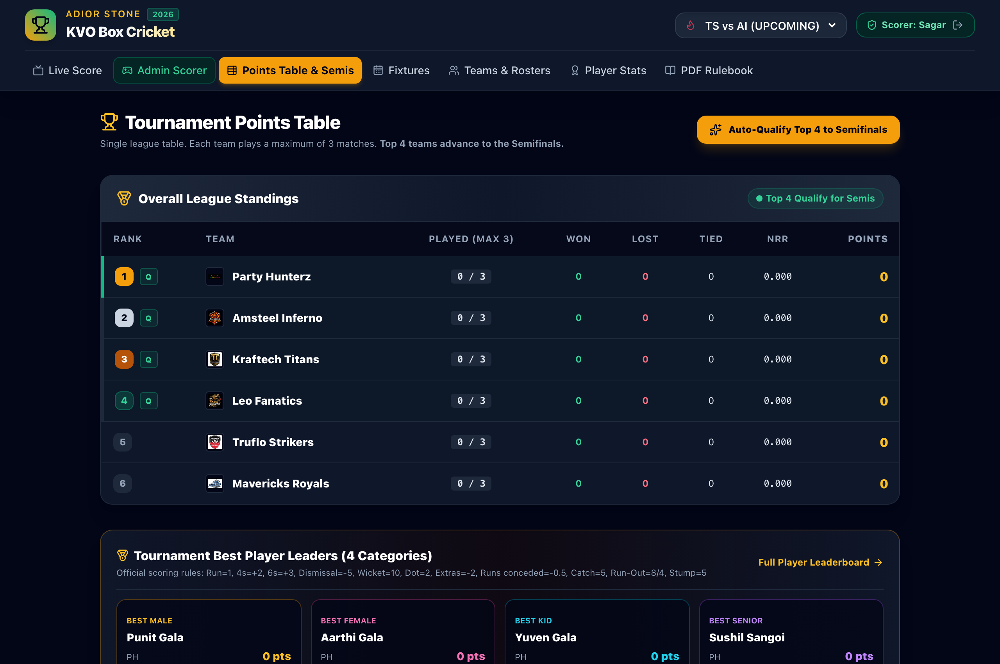

# KVO Box Cricket Tournament — Step-by-Step User & Scorer Manual

> **Adior Stones Presents KVO Box Cricket Tournament 2026**  
> **Date:** Sunday, 29th November 2026 • **Venue:** BCU Basecamp (Turf 1 & Turf 2)  
> **Teams:** 6 Official Franchises • **Format:** 8 Overs per Innings, 8 Players per Side

---

## Quick Reference & Table of Contents

| Section | Topic | Primary Audience |
| :--- | :--- | :--- |
| [1. Overview & Roles](#1-overview--role-permissions) | System access, Scorer & Admin credentials | Everyone / Scorers / Admins |
| [2. Public Live Scoreboard](#2-step-1--viewing-live-scores-spectator-mode) | Viewing real-time scores, commentary & stats | Spectators, Players, Captains |
| [3. Official Match Schedule](#3-step-2--viewing-fixtures--the-schedule) | 9 League matches, dual-turf layout & timings | Everyone |
| [4. Scorer & Admin Login](#4-step-3--logging-in-as-official-scorer-or-admin) | Quick switch: Sagar, Bhavin, Super Admin | Officials |
| [5. Pre-Match Setup (Playing 8)](#5-step-4--pre-match-playing-8-lineup-submission) | Mandatory categories: 1 Kid, 1 Female, 1 Senior, 5 Male | Scorers, Captains |
| [6. Ball-by-Ball Scoring](#6-step-5--scoring-deliveries-the-scorer-console) | Runs, Dots, Boundaries, Power Over, Extras | Scorers |
| [7. Dismissals & Fielding Attribution](#7-step-6--recording-wickets--fielding-attribution) | Caught, Direct Run-Out, Assisted Run-Out, Stumped | Scorers |
| [8. Score Correction & Editing Past Balls](#8-step-7--correcting-scores--editing-past-overs) | Current over (Scorers) vs Any past over (Admin) | Scorers, Super Admin |
| [9. Points Table & Semifinals](#9-step-8--points-table-nrr--playoffs) | NRR calculations, Top 4 qualifications, Finals | Everyone |
| [10. Player Stats & 4 Category Awards](#10-step-9--player-stats--4-category-best-player-awards) | Best Male, Female, Kid, and Senior points formula | Everyone |

---

## 1. Overview & Role Permissions

The application provides real-time scoring, live spectator broadcasting, and automated tournament standings for both Turf 1 and Turf 2 concurrently.

| User / Role | Default Credentials | Permitted Actions |
| :--- | :--- | :--- |
| **Public Spectator** | *No Login Required* | View live scoreboard, commentary, schedule, points table, and player statistics in real time. |
| **Sagar (Scorer - Turf 1)** | `sagar` / `kvo@2026` | Submit Playing 8, conduct toss, record ball-by-ball actions, **edit/undo deliveries in the active current over**. |
| **Bhavin (Scorer - Turf 2)** | `bhavin` / `kvo@2026` | Submit Playing 8, conduct toss, record ball-by-ball actions, **edit/undo deliveries in the active current over**. |
| **Super Admin** | `admin` / `kvo@2026` | Full tournament override, reset match, and **edit or delete any delivery from any past over in any innings**. |

---

## 2. Step 1 — Viewing Live Scores (Spectator Mode)

Anyone visiting the app can follow live matches without needing to log in.

### Key Features on the Live Scoreboard:
1. **Match Header:** Shows the competing teams, tournament stage (League, Semifinal, Final), and venue turf.
2. **Score & Equation:** Displays Current Runs / Wickets, Completed Overs, Current Run Rate (CRR), and Target Equation (Runs needed off balls remaining).
3. **Active Batters Card:** Shows striker (`*`) and non-striker, their individual runs, balls faced, strike rates, 4s, 6s, and gender/age category tags.
4. **Current Bowler Card:** Displays bowler figures (Overs, Maidens, Runs conceded, Wickets, Economy).
5. **Over Progression Strip:** Live badge feed of each ball in the active over (e.g., `1`, `•`, `4`, `Wkt`, `Wd`).
6. **Ball-by-Ball Commentary Feed:** Detailed breakdown with exact ball numbers, timestamps, and commentary.

---

## 3. Step 2 — Viewing Fixtures & the Schedule

Click the **Fixtures** tab in the top navigation bar to access the full tournament program.

### Schedule Layout:
- **Turf 1 vs Turf 2 Parallel Matches:** 9 scheduled league matches running simultaneously across both turfs between 9:00 AM and 2:00 PM.
- **Match Card Details:** Displays scheduled start time, playing teams with official logos, turf allocation, and current match status (`UPCOMING`, `LIVE`, or `COMPLETED`).
- **Official Poster & Day Timeline:** Scroll down to view the official schedule matrix and the full event timeline (Breakfast at 7:30 AM, Matches 1–9, Semifinals at 2:00 PM, Lunch at 2:00 PM, Grand Final at 3:30 PM, Prize Distribution at 5:00 PM).

---

## 4. Step 3 — Logging In as Official Scorer or Admin

To begin scoring or editing matches, official scorers and administrators must authenticate.

### How to Log In:
1. Click the **Scorer Login** button in the header navbar (or click **Admin Scorer** tab).
2. Use the **Quick Account Selector Chips**:
   - Tap **Sagar** (Turf 1 Scorer)
   - Tap **Bhavin** (Turf 2 Scorer)
   - Tap **Admin** (Super Admin)
3. Enter password: `kvo@2026`.
4. Click **Sign In as Official Scorer**. Upon success, your credentials are saved and the **Admin Scorer** tab unlocks.

---

## 5. Step 4 — Pre-Match Playing 8 Lineup Submission

Before scoring begins, both team captains must submit and verify their **Playing 8** roster per the official KVO tournament rules.

### Playing 8 Squad Rules:
- **Exact Squad Size:** Exactly **8 players** must be selected for each team.
- **Mandatory Category Quotas:**
  - At least **1 Kid** (Junior)
  - At least **1 Female**
  - At least **1 Senior**
  - Up to **5 Male (Regular)** players
- **Validation Indicator:** The system displays a live status badge:
  - 🟢 **Both Lineups Valid:** All criteria met. The **Confirm & Lock Playing 8** button activates.
  - 🔴 **Incomplete:** Highlights missing category requirements.
- Once locked, the scorer selects the **Toss Winner** and their decision (**Bat** or **Bowl**) to start Innings 1.

---

## 6. Step 5 — Scoring Deliveries (The Scorer Console)

The Scorer Console gives scorers a fast, touch-friendly keypad designed for rapid box cricket scoring.

### 1. Scoring Keypad Buttons:
- **Dot Ball (`• 0`):** No runs scored. Legal delivery.
- **`+1`, `+2`, `+3` Runs:** Regular running between wickets.
  - *Female Batter Bonus:* If a female batter is on strike, runs are automatically multiplied by 2 (+2, +4, +6).
- **`4 FOUR`:** Boundary along turf/net.
  - Regular Male: +4 runs.
  - Female: **+9 runs** `((4 x 2) + 1)`.
  - Kid / Senior: **+5 runs** `(4 + 1)`.
- **`6 SIX`:** Direct over the boundary net.
  - Regular Male: +6 runs.
  - Female: **+14 runs** `((6 x 2) + 2)`.
  - Kid / Senior: **+8 runs** `(6 + 2)`.
- **`1D` / `2D` Side Net:** Box cricket side declaration net runs.
- **`WIDE`:** Grants +1 extra run to the batting team. Does not count as a legal delivery (must be re-bowled).
- **`NO BALL`:** Grants +1 run and a **Free Hit** on the next ball.
  - *Leg Uplift No-Ball:* Optional prompt allows marking an illegal foot-lift bowling action (No Free Hit awarded per rulebook).

### 2. Power Over Toggle:
- The batting captain can declare **1 Power Over** per innings (between Overs 2 and 7) before the over commences.
- Tap **Declare Power Over**.
- During the Power Over, **all runs hit off the bat are doubled (2x)**.
- *Wicket Penalty:* Any dismissal during the Power Over costs the batting team **-5 runs** (or **-7 runs** if caught by a female fielder).

---

## 7. Step 6 — Recording Wickets & Fielding Attribution

When a dismissal occurs, tap the red **WICKET** button to launch the dismissal modal.

### Steps to Record a Wicket:
1. **Select Dismissal Type:**
   - **CAUGHT:** Choose the catching fielder from the fielding team roster. If the catch is taken by a female player, check **Caught by Female** (applies -4 run penalty in regular overs or -7 runs in Power Over).
   - **BOWLED:** Wicket is credited directly to the active bowler.
   - **RUN OUT:** Select who was dismissed (**Striker** or **Non-Striker**).
     - Select **Direct Hit** (attributes 15 fielding points to the thrower), OR
     - Select **Assisted Run-Out** (attributes 10 fielding points to the primary thrower + 5 points to the fielder/keeper breaking the stumps).
   - **STUMPED:** Choose the wicket keeper / fielder executing the stumping (+10 fielding points).
   - **HIT WICKET:** Wicket credited to bowler.
2. Tap **Confirm & Record Wicket**. The app applies the minus run deduction (Box cricket format), updates bowler figures, and attributes fielding points immediately.

---

## 8. Step 7 — Correcting Scores & Editing Past Overs

Accidents happen during fast-paced games. The app provides two levels of score correction:

### 1. Instant Undo:
- To immediately reverse the last delivery, tap the **Undo Ball** button in the top action bar.
- Restores the previous score, balls faced, strike, and player statistics instantly.

### 2. Over Log & Ball Editor:
- Tap the **Over Log & Edit** button to inspect any over.
- Filter by **Innings 1** or **Innings 2**, and select any **Over (1 to 8)**.
- Each ball displays the delivery number, outcome, batsman, bowler, and runs.

### Role-Based Edit Restrictions:
- **Scorer Permissions (`sagar`, `bhavin`):**
  - Official scorers can edit or delete balls in the **current active over only**.
  - Completed past overs display a yellow **🔒 PAST OVER (LOCKED FOR SCORER)** banner. Scorers cannot tamper with past overs.
- **Super Admin Permissions (`admin`):**
  - Super Admin has unrestricted access to edit or delete **any ball from any past over in any match**.
  - Selecting a ball allows changing runs, extras, bowler, batter, dismissal type, and commentary.
  - Scorecards, NRR, and player leaderboards are automatically recalculated.

---

## 9. Step 8 — Points Table, NRR & Playoffs

Tap the **Points Table & Semis** tab in the navbar to check the tournament standings.

### Standings System:
- **Win:** 2 Points | **Tie / No Result:** 1 Point | **Loss:** 0 Points.
- **Tie-Breaker:** **Net Run Rate (NRR)** = `(Total Runs Scored / Total Overs Faced) - (Total Runs Conceded / Total Overs Bowled)`.
- **Top 4 Qualification:** The top 4 ranked teams receive green qualification badges and automatically populate the **Semifinal Brackets**:
  - **Semifinal 1:** Rank 1 vs Rank 4
  - **Semifinal 2:** Rank 2 vs Rank 3
  - **Grand Final:** Winner SF1 vs Winner SF2

---

## 10. Step 9 — Player Stats & 4 Category Best Player Awards

Tap the **Player Stats** tab to view the official individual awards and player leaderboard.

### The 4 Category Awards:
Rather than generic best batsman or bowler trophies, awards are presented to the **top performing player in each demographic category**:
1. 🏆 **Best Male Player**
2. 🏆 **Best Female Player**
3. 🏆 **Best Kid Player** (Junior)
4. 🏆 **Best Senior Player**

### Official Points Calculation Rules (from Excel Specification):
> **Strict Batting Multiplier Rule:**  
> To ensure fairness across all player categories, **Power Over 2x multipliers and gender bonus runs are strictly EXCLUDED** when calculating player performance points. Only actual physical runs hit off the bat are counted!

#### Points Breakdown Table:
| Performance Event | Points Awarded | Notes |
| :--- | :--- | :--- |
| **Runs Scored** | **+1 Point** per actual run | Base runs hit off the bat (Power Over 2x excluded) |
| **Boundary (Four)** | **+2 Points** | Additional bonus on top of runs |
| **Boundary (Six)** | **+4 Points** | Additional bonus on top of runs |
| **25 Runs Milestone** | **+10 Points** | Bonus for reaching 25 runs in an innings |
| **50 Runs Milestone** | **+25 Points** | Bonus for reaching 50 runs in an innings |
| **Wicket Taken** | **+20 Points** | Credited to the bowler (excluding run-outs) |
| **Dot Ball Bowled** | **+2 Points** | Dot ball delivery by bowler |
| **Maiden Over Bowled** | **+25 Points** | 0 runs conceded in a full legal over |
| **Catch Taken** | **+10 Points** | Credited to the catching fielder |
| **Stumping** | **+10 Points** | Credited to the wicket keeper / fielder |
| **Direct Hit Run-Out** | **+15 Points** | Credited to the thrower |
| **Assisted Run-Out (Thrower)** | **+10 Points** | Primary thrower who initiated the run-out |
| **Assisted Run-Out (Stumps)** | **+5 Points** | Fielder or keeper breaking the wickets |

---

## Summary Checklist for Match Day

- [ ] **7:30 AM:** Scorers arrive, inspect Turfs 1 & 2, log in with `sagar` / `bhavin` (`kvo@2026`).
- [ ] **8:45 AM:** Team captains submit Playing 8 (ensure 1 Kid, 1 Female, 1 Senior, 5 Male).
- [ ] **9:00 AM:** Match 1 (Turf 1: Truflo Strikers vs Amsteel Inferno) & Match 2 (Turf 2: Kraftech Titans vs Mavericks Royals) begin!
- [ ] **During Match:** Use keypad for runs, declare Power Over when requested, attribute catches and run-outs accurately.
- [ ] **Post-Match:** Confirm scorecard. Standings and Best Player points update automatically!
